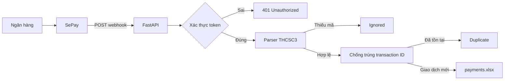

# Tool Bank — SePay THCSC3 Tracker

> Hệ thống tự động tiếp nhận giao dịch từ SePay, lọc nội dung chuyển khoản theo mã `THCSC3` và lưu danh sách người chuyển tiền vào Excel.

[](https://www.python.org/)
[](https://fastapi.tiangolo.com/)
[](#ki%E1%BB%83m-th%E1%BB%AD)

## Giới thiệu

**Tool Bank** là mini project xây dựng bằng Python và FastAPI, phục vụ việc theo dõi các khoản chuyển tiền có nội dung theo mẫu:

```text
<Tên người chuyển> THCSC3
```

Ứng dụng nhận webhook từ SePay, xác thực request bằng Bearer token, phân tích nội dung chuyển khoản và ghi giao dịch hợp lệ vào file `payments.xlsx`.

Project được xây dựng theo hướng tách lớp rõ ràng, dễ học, dễ kiểm thử và có thể mở rộng thêm database hoặc giao diện quản trị trong tương lai.

## Luồng xử lý



## Tính năng

- Nhận webhook giao dịch từ SePay.
- Xác thực `Authorization: Bearer <token>`.
- Hỗ trợ nội dung không phân biệt chữ hoa, chữ thường.
- Lọc giao dịch có mã `THCSC3`.
- Tách tên người chuyển và giữ lại nội dung gốc.
- Ghi dồn vào một file Excel duy nhất.
- Chống ghi trùng bằng transaction ID.
- Có khóa ghi file để xử lý request đồng thời an toàn hơn.
- Có test parser và test webhook bằng pytest.
- Có thể expose server local qua Ngrok để SePay truy cập.

## Công nghệ sử dụng

| Công nghệ | Mục đích |
|---|---|
| Python 3.10+ | Ngôn ngữ chính |
| FastAPI | Xây dựng HTTP API |
| Uvicorn | Chạy ứng dụng ASGI |
| Pydantic Settings | Quản lý cấu hình môi trường |
| openpyxl | Đọc và ghi file Excel |
| pytest | Kiểm thử tự động |
| Ngrok | Tạo HTTPS public cho môi trường local |

## Cài đặt

Mở PowerShell tại thư mục dự án:

```powershell
cd d:\tool_bank
python -m venv venv
.\venv\Scripts\Activate.ps1
pip install -r requirements.txt
```

Tạo file cấu hình local:

```powershell
Copy-Item .env.example .env
```

Điền các giá trị phù hợp vào `.env`:

```env
SEPAY_API_TOKEN=your_sepay_api_token
SEPAY_WEBHOOK_AUTH_TOKEN=your_webhook_secret
BANK_ACCOUNT_NUMBER=your_bank_account
EXPECTED_CODE=THCSC3
EXCEL_OUTPUT_DIR=data/exports
EXCEL_FILE_NAME=payments.xlsx
APP_HOST=127.0.0.1
APP_PORT=8000
```

> Không commit `.env`, token hoặc dữ liệu giao dịch thật lên Git.

## Kiểm thử

Chạy toàn bộ test:

```powershell
pytest -v
```

Bộ test hiện tại kiểm tra:

- Parser xử lý nội dung hợp lệ.
- Parser loại nội dung thiếu `THCSC3`.
- Token sai vẫn trả `401` khi body không hợp lệ.
- Nhiều request đồng thời không làm hỏng workbook.
- Nhiều request cùng transaction ID chỉ ghi một dòng.

Kết quả hiện tại:

```text
6 passed
```

## Chạy ứng dụng

```powershell
uvicorn app.main:app --host 0.0.0.0 --port 8000
```

Kiểm tra server:

```powershell
Invoke-RestMethod http://127.0.0.1:8000/health
```

Kết quả:

```json
{"status":"ok"}
```

API documentation của FastAPI có thể xem tại:

```text
http://127.0.0.1:8000/docs
```

## Webhook API

### Endpoint

```text
POST /api/webhooks/sepay
```

### Header

```text
Authorization: Bearer <SEPAY_WEBHOOK_AUTH_TOKEN>
Content-Type: application/json
```

### Payload mẫu

```json
{
  "content": "NGUYEN VAN A THCSC3",
  "transferAmount": 10000,
  "transactionDate": "2026-10-25 10:00:00",
  "id": "transaction-001"
}
```

### Response

Giao dịch hợp lệ và chưa tồn tại:

```json
{"success":true,"status":"ok"}
```

Các trạng thái khác:

| Status | Ý nghĩa |
|---|---|
| `ok` | Đã ghi giao dịch mới vào Excel |
| `ignored` | Nội dung không chứa `THCSC3` |
| `duplicate` | Transaction ID đã tồn tại |

## Kết nối SePay qua Ngrok

Giữ Uvicorn đang chạy và mở terminal khác:

```powershell
ngrok http 8000
```

Copy URL HTTPS Ngrok vào cấu hình webhook của SePay:

```text
https://your-ngrok-domain.ngrok-free.app/api/webhooks/sepay
```

SePay cần gửi Authorization token giống giá trị `SEPAY_WEBHOOK_AUTH_TOKEN` trong `.env`.

## Dữ liệu Excel

File kết quả mặc định:

```text
data/exports/payments.xlsx
```

Tên sheet:

```text
payments
```

Các cột dữ liệu:

```text
thoiGian | ten | maThamChieu | soTien | noiDungGoc | transactionId
```

Không mở file Excel trong lúc server đang nhận webhook. Microsoft Excel có thể khóa file và khiến `openpyxl` gặp lỗi `PermissionError` khi lưu.

## Cấu trúc dự án

```text
app/
├── api/webhooks/sepay.py       # Endpoint và xác thực webhook
├── core/config.py              # Đọc cấu hình từ môi trường
├── models/payment.py           # Mô hình Payment
├── services/parser.py          # Phân tích nội dung THCSC3
├── services/excel_exporter.py  # Ghi Excel và chống trùng
└── main.py                     # Khởi tạo FastAPI

tests/
├── test_parser.py              # Test parser
└── test_webhook.py             # Test API webhook

pytest.ini                      # Cấu hình pytest
.env.example                   # Mẫu biến môi trường
requirements.txt               # Danh sách thư viện
```

## Bảo mật và giới hạn

- Không hardcode secret trong source code.
- Không commit `.env` và file Excel chứa dữ liệu thật.
- Chỉ dùng giao dịch nhỏ khi kiểm thử thực tế.
- Ngrok miễn phí có thể thay đổi URL sau mỗi lần khởi động.
- Uvicorn và Ngrok phải tiếp tục chạy để nhận webhook.
- Excel phù hợp cho mini project hoặc quy mô nhỏ; khi dữ liệu lớn nên chuyển sang database.

## Trạng thái project

Project mini đã hoàn thiện các chức năng cốt lõi:

- Nhận webhook.
- Xác thực request.
- Parse nội dung `THCSC3`.
- Ghi Excel.
- Chống trùng giao dịch.
- Kiểm thử tự động.
